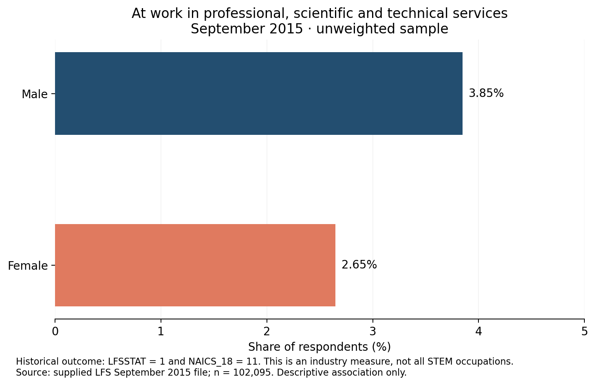

# Gender and Family Factors in Canadian Labour Market Participation

**Lyncy Li · ECON 472 · R / Python · Logistic regression · Survey microdata**

An empirical research project examining associations between sex, family characteristics, and employment in professional, scientific and technical services in Canada. Originally submitted in December 2024 under the title *Gender Disparities in Canadian STEM Labor Force Participation: The Role of Family-Related Factors*.

**Reproduction status:** The original paper's two model tables have been independently reproduced in Python from the supplied September 2015 file. All 10 coefficients and their standard errors agree within the paper's rounding precision. All 12 monthly files were inspected. The companion R scripts have been reviewed but have not been executed in this environment.

## Research questions

- Does the historical industry-based outcome differ by sex?
- How do its associations with marital status and child-age indicators vary by sex?
- Can the submitted estimates be reproduced, and which coding or interpretation choices need revision?

## Data and verified scope

| Item | Verified information |
|---|---|
| Source | Statistics Canada Labour Force Survey, original 2015 files supplied by the author; paper cites ODESI |
| Available inputs | 12 monthly RData files and a January seven-variable tabular subset |
| Reproduced sample | September 2015, 102,095 records, 79 source variables |
| Historical outcome | `LFSSTAT == 1 & NAICS_18 == 11` |
| Observed positives | 3,296 records (3.2284% of the September sample) |
| Model 1 | Unweighted logistic regression on the original sex coding (1=male, 2=female) |
| Model 2 | Logistic regression with sex-by-family interactions and historical outcome-class weights |

The outcome selects respondents at work in **professional, scientific and technical services**. It is not a comprehensive STEM occupation measure or the general labour force participation rate. The original essay is retained as a historical report; the repository uses more precise wording.



## Methods and reproducibility

The project includes data-file inventory and fingerprints, variable-label extraction, descriptive statistics, binary logistic models, interaction terms, and automated comparison with the paper's printed tables. Microdata are not included in the repository package.

```sh
python -m pip install -r requirements.txt
python scripts/reproduce.py --data-dir data/raw --output results/verified
```

Place the supplied monthly `.RData` files in `data/raw/` first. The January `.tab` subset is optional; when present, the script checks it against January's RData. Run from the repository root.

The companion base-R workflow is:

```sh
Rscript R/01_inventory.R data/raw results/inventory
Rscript R/02_reproduce_original.R data/raw/lfs-71M0001XCB-E-2015-September_F1.RData results/r_reproduction
```

No automatic data download is performed. The R scripts preserve the historical coding intentionally. Their class-weighted binomial fit may emit a non-integer-count warning; that warning is not hidden.

## Selected reproduced results

| Historical specification | Term | Coefficient |
|---|---|---:|
| Baseline | SEX (1 to 2) | -0.386670 |
| Class-weighted extended model | SEX | -0.264511 |
| Class-weighted extended model | SEX × youngest child 0–5 indicator | -0.346243 |

These are log-odds coefficients. The extended model's SEX coefficient is conditional on the family indicators being zero. Class-weighted standard errors are included solely to reproduce the paper, not as validated survey-design inference. See the full [comparison table](results/verified/paper_comparison.csv).

## Findings from the reproduction audit

- Every monthly file contains an object named `table`. The original sequential loads overwrite it; the last file is September. No annual row binding was performed.
- The original formulas use `table$SEX` (1/2), overriding the separately created 0/1 vector. This explains the reported intercepts and changes the interpretation of interaction-model main effects.
- The historical 6–17 child-age indicator omits code 4 (ages 13–15): 3,280 September records. The reproduction preserves that omission; a corrected specification must be labelled separately.
- The original class weights are not the supplied `FWEIGHT` survey weights.
- Blank child-age entries cannot all be described as ordinary missing responses. Applicability must be checked before changing them to zeros or dropping them.

This is an observational association study. It does not implement a causal policy evaluation or difference-in-differences design. Negative logit interaction coefficients alone do not establish negative probability effects.

## Repository guide

| Path | Content |
|---|---|
| `archive/original_user_code.R` | Archived source, including original paths and unsuccessful model attempt |
| `R/` | Isolated monthly-file inventory and explicit historical reproduction |
| `scripts/reproduce.py` | Executed Python reproduction, checks, and figure generation |
| `results/verified/` | Aggregate outputs, comparisons, file inventory, labels, and environment record |
| `docs/reproduction_notes.md` | Audit details, interpretation and remaining limitations |
| `data/README.md` | Data placement, verified codes, and release-vintage warning |
| `reports/original_essay_redacted.pdf` | Original essay with student-number line removed |

Original study and source analysis: **Lyncy Li**. Repository refactoring and independent reproduction were prepared with AI assistance in October 2026. No open-source license has yet been selected. Source-data terms remain separate from this project's code and report.
